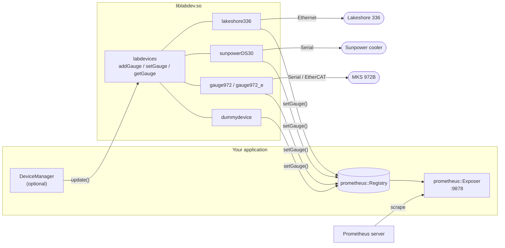
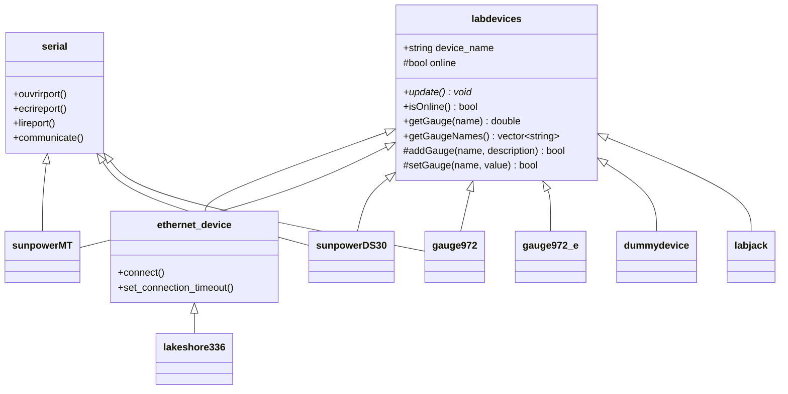
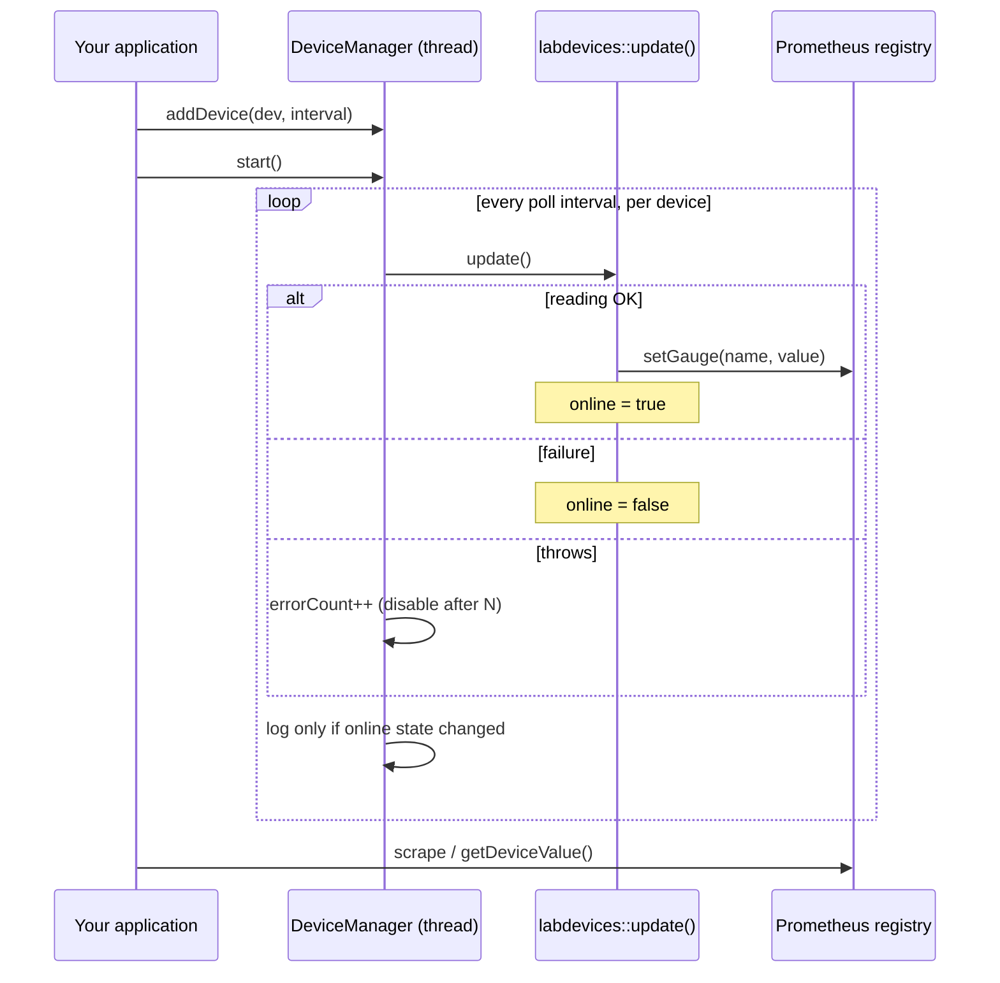

# labdev.lib

**A C++17 library of laboratory instrument drivers that publish every reading as a [Prometheus](https://prometheus.io) gauge.**

[](LICENSE)


`labdev.lib` builds `liblabdev.so`. It is a collection of device drivers (temperature controllers, vacuum gauges, cryocoolers, DAQ) that all derive from one small base class, `labdevices`. Each driver talks to its instrument over Ethernet, serial or EtherCAT, and pushes what it reads into a Prometheus gauge. Your application links `-llabdev`, exposes the registry, and Prometheus does the rest.

📖 Project page: see [`here`](https://espressjo.github.io/liblabdev/) (GitHub Pages).

---

## Contents

- [Why](#why)
- [Supported devices](#supported-devices)
- [Architecture](#architecture)
- [Quick start](#quick-start)
- [DeviceManager](#devicemanager)
- [Writing a new device](#writing-a-new-device)
- [Logging](#logging)
- [Building and installing](#building-and-installing)
- [Repository layout](#repository-layout)
- [Conventions and gotchas](#conventions-and-gotchas)

## Why

- **One interface.** Every instrument is a `labdevices`: construct it, call `update()`, read gauges.
- **The gauge is the cache.** `update()` pushes values into Prometheus gauges and `getGauge()` reads the last one back. There is no second copy of the data to keep in sync.
- **Faults stay local.** The optional `DeviceManager` polls devices from one thread and isolates failures, so one dead instrument does not stop the others.
- **Cheap to extend.** A new instrument is one class and one small Makefile.

## Supported devices

| Class | Instrument | Transport | Config keys | Default build |
|---|---|---|---|---|
| `lakeshore336` | Lakeshore 336 temperature controller | Ethernet | `LSIP`, `LSPORT` | ✅ |
| `sunpowerMT` | Sunpower cryocooler controller (MT) | Serial | none (`port, baudrate` constructor) | ✅ |
| `sunpowerDS30` | Sunpower DS30 cryocooler controller | Serial | `DEVICE`, `BAUDRATE` | ✅ |
| `gauge972` | MKS 972B vacuum gauge | Serial | `PORT`, `BAUDRATE` | ✅ |
| `gauge972_e` | MKS 972B vacuum gauge | EtherCAT (SOEM) | `NIC` | ✅ |
| `dummydevice` | Fake device for testing | none | none | ✅ |
| `labjack` | LabJack DAQ (T4/T7) | Ethernet / USB via LJM | `IP`, `LJACKTYPE`, `CONNECTIONTYPE` | ❌ needs the LJM SDK, see [`src/devices/labjack/README.md`](src/devices/labjack/README.md) |

Every gauge carries the label `{Component="<device name>"}`. Two devices can both expose a gauge named `A` and Prometheus tells them apart by that label.

Both MKS 972B drivers are interchangeable for a consumer. They expose the same gauge name, `<devicename>_Pressure`, and the same public API, so you can swap serial for EtherCAT without touching your code.

<details>
<summary>Gauges per device</summary>

| Device | Gauges |
|---|---|
| `lakeshore336` | `A`, `B`, `C`, `D`, `D1`–`D5`, `setpoint1`–`setpoint4`, `heater1`, `heater2`, `analogueOut1`, `analogueOut2` |
| `sunpowerMT`, `sunpowerDS30` | `VDC`, `POWER_CMD`, `TC`, `RT`, `WT`, `VrmsOutA`, `IrmsOutA`, `PA`, `PB`, `VrmsOutB`, `IrmsOutB`, and on the DS30 also `C_ERROR`, `NC_ERROR` |
| `gauge972`, `gauge972_e` | `<devicename>_Pressure` |
| `dummydevice` | `Dummy` |
| `labjack` | `<devicename>AIN0`, `<devicename>AIN1` |

</details>

## Architecture



### Class hierarchy



## Quick start

### 1. Poll a device by hand

You do not need `DeviceManager`. Create a registry, construct a device, call `update()` when you want a fresh reading.

```cpp
#include <labdev/lakeshore336.h>
#include <prometheus/exposer.h>
#include <prometheus/registry.h>
#include <iostream>
#include <thread>

int main() {
  prometheus::Exposer exposer{"0.0.0.0:9878"};
  auto registry = std::make_shared<prometheus::Registry>();
  exposer.RegisterCollectable(registry);

  // explicit constructor: IP, port, device name, extended inputs, registry
  lakeshore336 ls("192.168.1.50", 7777, "D_Lakeshore", true, registry.get());

  for (;;) {
    ls.update();                       // reads the instrument, pushes gauges
    if (ls.isOnline())
      std::cout << "A = " << ls.getGauge("A") << " K\n";   // read back the cache
    std::this_thread::sleep_for(std::chrono::seconds(1));
  }
}
```

Then point Prometheus at `host:9878/metrics`.

### 2. Let `DeviceManager` do the polling

See the next section.

### 3. Link it

```bash
g++ -std=c++17 app.cpp -o app \
    -llabdev -luics -lsoem -lprometheus-cpp-pull -lprometheus-cpp-core -lpthread
# -lsoem is only needed if you use gauge972_e
```

## DeviceManager

`DeviceManager` is a **ready-made polling loop for applications**. The drivers never use it themselves, and you can ignore it and call `update()` yourself. Use it when you have several devices and want:

- **one background thread** polling all of them, each at its own interval;
- **fault isolation**: every `update()` runs in a try/catch, and a device that throws `maxErrorsBeforeDisable` times in a row is disabled instead of taking the loop down;
- **runtime control**: enable or disable a device, change its poll interval, list devices and gauges, ask whether a device is online, read its last value;
- **automatic logging** of online/offline transitions for every device, with no per-device code.



### Usage

This is how the `cpapir2` application wires it up (trimmed):

```cpp
#include <labdev/devicesManager.h>
#include <labdev/dummydevice.h>
#include <labdev/lakeshore336.h>
#include <labdev/mks972b-ethercat.h>
#include <labdev/sunpowerDS30.h>
#include <prometheus/exposer.h>
#include <prometheus/registry.h>

void setup_devices() {
  // 1. Metrics endpoint and a registry shared by every device
  auto exposer  = new prometheus::Exposer("0.0.0.0:9878");
  auto registry = std::make_shared<prometheus::Registry>();

  // 2. The manager, default poll interval 5 s
  auto manager = new DeviceManager(registry.get(), std::chrono::milliseconds(5000));

  // 3. Devices, built from their config files
  auto pressure  = std::make_shared<gauge972_e>("/opt/app/config/mks972b.cfg",
                                                "D_Pressure", registry.get());
  auto lakeshore = std::make_shared<lakeshore336>("/opt/app/config/lakeshore.cfg",
                                                  "D_Lakeshore", -1, true, registry.get());
  auto sunpower  = std::make_shared<sunpowerDS30>("/opt/app/config/sunpower.cfg",
                                                  "D_Sunpower", registry.get());

  // 4. Publish the registry, register devices, start polling
  exposer->RegisterCollectable(registry);
  manager->addDevice(pressure);
  manager->addDevice(lakeshore, std::chrono::milliseconds(2000)); // custom interval
  manager->addDevice(sunpower);
  manager->start();
}
```

### Querying and controlling at runtime

```cpp
double p;
if (manager->getDeviceValue("D_Pressure", "D_Pressure_Pressure", p) &&
    manager->deviceOnline("D_Pressure"))
  std::cout << "pressure: " << p << " Torr\n";

manager->disableDevice("D_Lakeshore");                              // stop polling it
manager->setDevicePollInterval("D_Sunpower", std::chrono::milliseconds(10000));
manager->enableDevice("D_Lakeshore");

for (auto &name : manager->getDeviceNames())
  for (auto &g : manager->getDeviceGaugeNames(name))
    std::cout << name << " -> " << g << "\n";

manager->setErrorCallback([](const std::string &dev, const std::string &err) {
  std::cerr << dev << ": " << err << "\n";
});
```

| Method | Purpose |
|---|---|
| `addDevice(dev, interval)` / `removeDevice(name)` | Register or drop a device. Interval `0` uses the default. |
| `start()` / `stop()` / `isRunning()` | Control the polling thread. |
| `enableDevice` / `disableDevice` / `isDeviceEnabled` | Pause one device without removing it. |
| `setDefaultPollInterval` / `setDevicePollInterval` / `getDevicePollingTime` | Polling cadence. |
| `setMaxErrorsBeforeDisable(n)` | Consecutive throws before auto-disable. |
| `deviceOnline(name)` / `deviceExist(name)` | Device state. |
| `getDeviceValue(dev, gauge, value)` / `getDeviceGaugeNames(dev)` | Last value read, no I/O. |
| `getDeviceNames` / `getDeviceCount` / `getEnabledDeviceCount` / `getDeviceErrorCount` | Inventory and health. |
| `setErrorCallback(fn)` | Be notified of device exceptions. |
| `getDevice<T>(name)` | Typed access to call device-specific methods. |

> **Thread-safety warning.** `getDevice<T>()` hands you the device, and what you call on it runs on **your** thread while `update()` may be running on the polling thread. The transports are not mutex protected. If the call does I/O (for example `lakeshore336::setp_1()` or `sunpowerDS30::setCoolerOn()`), call `disableDevice(name)` first and `enableDevice(name)` afterwards.

## Writing a new device

1. Create `src/devices/<name>/` with a Makefile copied from `src/devices/lakeshore-336/Makefile` (adjust `SRCS`).
2. Add the directory to both `all:` and `clean:` in `src/devices/Makefile`.
3. Derive from `labdevices` plus a transport:
   - Ethernet: `class X : public ethernet_device`
   - Serial: `class X : public labdevices, public serial`
   - Anything else: `class X : public labdevices`
4. Register one gauge per reading **in the constructor** with `addGauge(name, description)`.
5. Override `update()`. Set `online = true` on entry, call `setGauge(...)` for every successful reading, and set `online = false` on any failure. Return quickly, because a `DeviceManager` runs every device on one thread.
6. Offer an explicit constructor (`IP, port` or `port, baudrate`) and a config-file one that reads its values with `cfg_get_int` / `cfg_get_string` from `uics/uics_config.h`.

```cpp
class mydevice : public labdevices, public serial {
public:
  mydevice(int port, int baudrate, std::string name, prometheus::Registry *reg)
      : labdevices(name, reg) {
    addGauge("Temperature", "Sensor temperature (K)");
    status = ouvrirport(port, baudrate);
  }

  void update() override {
    online = true;
    std::string reply = communicate("TEMP?\r", 64, true);
    if (exchange_status != VALID) { online = false; return; }
    setGauge("Temperature", std::stod(reply));
  }
};
```

## Logging

`liblabdev` writes a daily log to **`/var/tmp/labdev/yyyymmdd.txt`** (GMT timestamps, default level `LOG_INFO`), on top of the usual console diagnostics.

```cpp
#include <labdev/labdev_log.h>
labdev::log_set_path("/var/log/myapp/labdev/"); // before constructing any device
labdev::log_set_level(labdev::LOG_WARN);        // -1 silences the log
```

What is logged: construction, transport open/connect/close, hardware faults and online/offline transitions. What is **never** logged: readings and per-transaction I/O. Those run at the polling rate and would fill the disk. Faults inside a polling loop use `labdev::log_latch`, which writes once when a fault begins and once when it clears.

## Building and installing

Requirements: a C++17 compiler, [prometheus-cpp](https://github.com/jupp0r/prometheus-cpp) and [SOEM](https://github.com/espressjo/SOEM) (both git submodules under `external/`), and **UICS** (`-luics`, headers in `/usr/local/include/uics/`). The optional `labjack` device also needs LabJack's LJM SDK.

```bash
git clone --recurse-submodules https://github.com/espressjo/liblabdev && cd liblabdev

# once: dependencies
cd external && make clean all && sudo make install && cd ..

# the library
make all            # builds into ./build
make all            # a fully clean build needs this twice, see below
sudo make install   # /usr/local/lib and /usr/local/include
```

Consumers then include `<labdev/<device>.h>` (or the generated umbrella `labdev.h`) and link `-llabdev`.

## Repository layout

```
labdev.lib/
├── src/
│   ├── core/            transports and infrastructure
│   │                    serial, ethernet, ethernet_devices, labdevices,
│   │                    devicesManager, labdev_log, states_io.h
│   └── devices/         one directory per instrument, each with its own Makefile
│       ├── lakeshore-336/   sunpowerMT/   sunpowerDS30/
│       ├── mks972b-serial/  mks972b-ethercat/
│       ├── dummy-device/    labjack/ (optional, needs LJM)
├── external/            SOEM and prometheus-cpp submodules
├── extra/makeheader.py  generates build/include/labdev.h
├── python/tools/        prototyping scripts (not part of the build)
├── docs/index.html      project page
└── SPEC.md              specification
```

## Conventions and gotchas

- **Build twice from clean.** The root Makefile expands `$(wildcard build/*.o)` before anything is compiled, so the first run links an almost empty `.so`.
- **Stale objects get linked.** After removing or renaming a source file, run `make clean` first.
- `build/include/labdev.h` is generated. Do not edit it.
- The serial layer keeps its original French identifiers (`ouvrirport`, `lireport`, `ecrireport`, `fermerport`). Consumers call them, so they are not renamed.
- Always call `set_connection_timeout(...)` before `connect()` on an `ethernet_device`. Without it, a dead instrument hangs the caller.
- Code style is `clang-format` LLVM.

## License

[MIT](LICENSE) © 2026 espressjo
